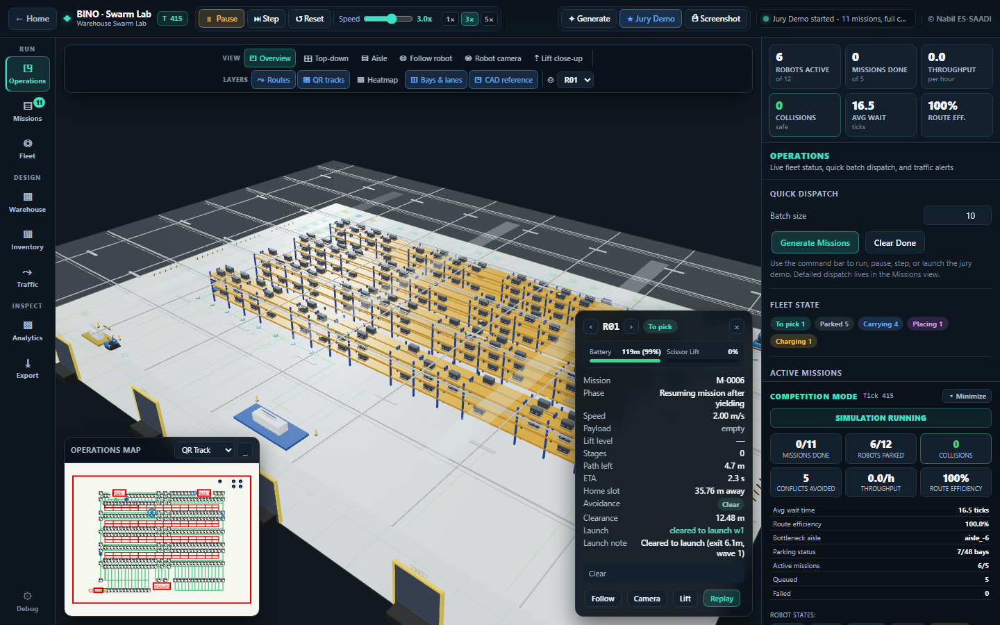
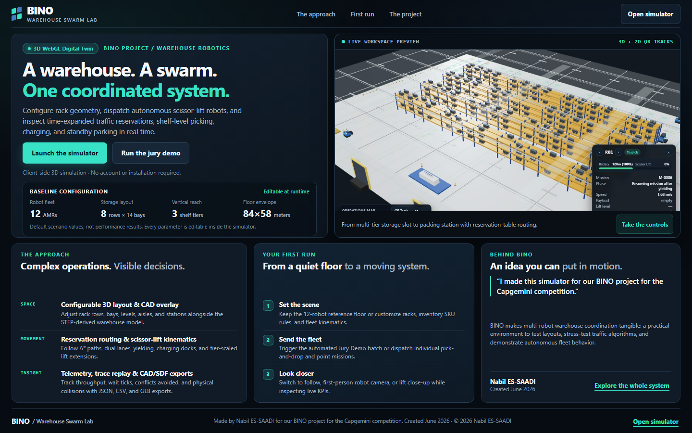
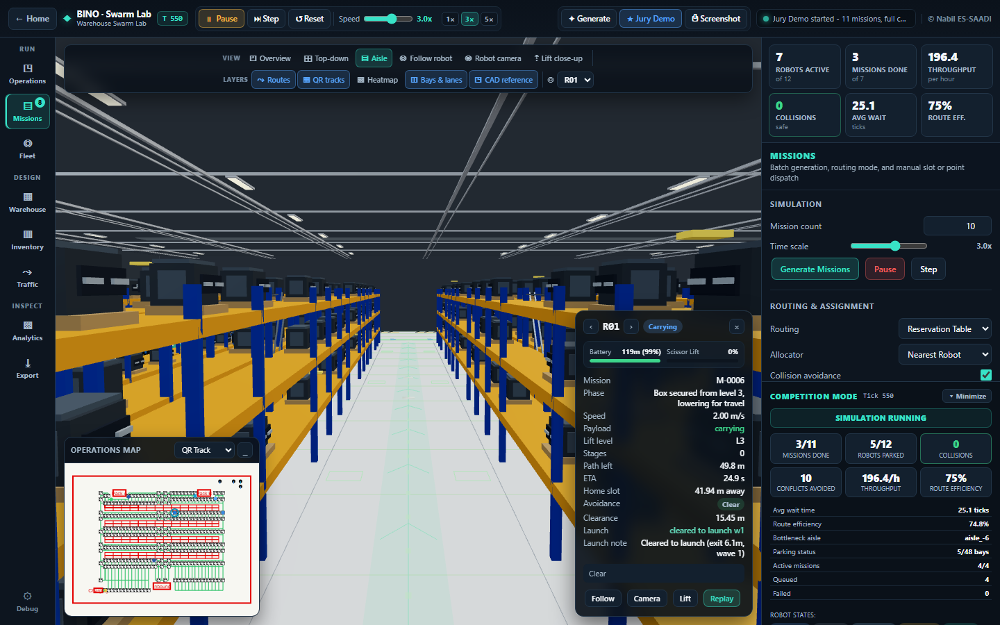

# BINO — Warehouse Swarm Lab

### Interactive 3D Multi-Agent Simulation for Warehouse Robot Coordination

[](https://warehouse-swarm-sim.vercel.app/)
[](https://warehouse-swarm-sim.vercel.app/simulator/)
[](https://warehouse-swarm-sim.vercel.app/simulator/?demo=jury)
[](https://www.typescriptlang.org/)
[](https://threejs.org/)
[](https://vite.dev/)
[](#verification--quality-assurance)

Design an industrial warehouse layout, dispatch a coordinated fleet of autonomous scissor-lift mobile robots, and inspect how spatial geometry, time-expanded route reservations, shelf-level picking kinematics, station queues, battery management, and standby parking interact in real time inside a browser-based 3D engineering workspace.

Developed by **Nabil ES-SAADI** for the **BINO project for the Capgemini competition**. Created in **June 2026**.

**[Project Website](https://warehouse-swarm-sim.vercel.app/)** · **[Launch 3D Simulator](https://warehouse-swarm-sim.vercel.app/simulator/)** · **[Start Jury Demo](https://warehouse-swarm-sim.vercel.app/simulator/?demo=jury)** · **[Scenario Parameters Reference](docs/SCENARIO_PARAMETERS.md)**

---



*Live BINO simulator workspace (`/simulator/`). Includes the 3D WebGL digital twin, categorized left navigation rail, floating camera & layer toolbar, 2D QR-track operations radar, selected-robot telemetry inspector with battery/lift progress bars, and real-time KPI sidebar.*

| 100vh Project Landing Page (`/`) | Aisle-Level Corridor & Mission Control (`/simulator/`) |
| --- | --- |
|  |  |
| *Single-viewport (`100vh`) responsive landing page with zero Three.js bundle overhead on initial load.* | *Dual-lane picking corridor perspective (`Aisle` camera preset) with reservation-table routing and live mission controls.* |

---

## Contents

- [Overview](#overview)
- [Quick Demo Walkthrough](#quick-demo-walkthrough)
- [System Capabilities](#system-capabilities)
- [Default Scenario Configuration](#default-scenario-configuration)
- [Quick Start & Local Development](#quick-start--local-development)
- [Using the Simulator Workspace](#using-the-simulator-workspace)
- [Architecture & Repository Layout](#architecture--repository-layout)
- [Verification & Quality Assurance](#verification--quality-assurance)
- [Deployment on Vercel](#deployment-on-vercel)
- [Project Resources & Media Tooling](#project-resources--media-tooling)
- [Author and Project Credit](#author-and-project-credit)

---

## Overview

Warehouse automation involves far more than computing a shortest path for a single vehicle. In an active fulfillment floor, autonomous mobile robots (AMRs) must share picking aisles, reserve inventory slots, extend scissor lifts to multi-tier shelf heights, queue cleanly at packing and inbound stations, monitor battery reserves, yield or reroute around opposing traffic, and return to conflict-free standby bays when idle.

**BINO — Warehouse Swarm Lab** makes these coupled operational decisions visible, measurable, and configurable:

- **Explorable 3D Digital Twin:** Combines procedural warehouse geometry (pallet racks, shelf systems, bin walls, hazard lanes, bollards, dock doors) with a tessellated CAD reference overlay ([`public/models/warehouse-from-step.glb`](public/models/warehouse-from-step.glb)).
- **Deterministic Multi-Agent Coordination:** Runs a 100 ms discrete-tick simulation engine supporting A* and time-expanded reservation-table routing, directional aisle lanes, predictive collision avoidance, and multi-stage deadlock recovery.
- **Two-Page Client-Side Architecture:** The public homepage (`/`) introduces the project with zero Three.js bundle overhead; the full interactive simulator runs at `/simulator/` on the same deployment. All simulation logic and browser saves execute locally on the client without requiring a backend server or user account.

### Quick Demo Walkthrough

1. **Launch the automated demonstration:** Open **[Start Jury Demo](https://warehouse-swarm-sim.vercel.app/simulator/?demo=jury)**. The simulator loads the warehouse reference model and immediately dispatches a coordinated demonstration batch.
2. **Observe multi-agent dynamics:** Watch robots depart their parking bays, navigate dual-lane picking aisles, elevate their scissor lifts to target shelf tiers, deliver payloads to packing/inbound stations, and dispatch low-battery units to the charging dock.
3. **Switch camera perspectives:** Select any robot in the 3D scene or use the top camera toolbar to switch between **Overview**, **Top-down**, **Aisle**, **Follow robot**, first-person **Robot camera**, and **Lift close-up** views.
4. **Inspect live telemetry:** Review mission completion progress, hourly throughput estimates, wait times, physical collision counts, and proactive conflict-avoidance counters across the workspace panels and 2D operations map.

> [!TIP]
> Use **Home** in the simulator header at any time to return to the project introduction page. To restart the automated showcase during a session, click **Jury Demo** in the simulator command bar.

---

## System Capabilities

| Subsystem | Implemented Engineering Capabilities |
| --- | --- |
| **Warehouse Geometry & Layout** | Configurable floor footprint (`width × depth`), rack rows, bays per row, vertical shelf levels, row pitch, picking aisle width, main & cross-aisles, station coordinates, structural columns, safety bollards, dock doors, and aligned `.glb` CAD reference overlays. |
| **Inventory & Slotting** | Procedural SKU family generation, configurable slot fill rates, hot-SKU and empty-slot distributions, per-row inventory rules, atomic source-slot reservations, and full inventory CSV import/export. |
| **Autonomous Robot Fleet** | Adjustable fleet size, cruise speed, turn rate, smooth acceleration/deceleration profiles (`m/s²`), chassis footprint, maximum lift height, battery capacity, 4 built-in chassis visuals (`scissor-lift`, `compact-lift`, `stacker-amr`, `tote-carrier`), and custom `.glb` robot model loading. |
| **Mission Control & Dispatch** | Automated batch generation, manual **Pick and Drop** slot dispatch, manual **Go to Position** (`X/Z`) navigation, configurable active-mission concurrency caps with auto-scaling, and four task allocators (`nearest-robot`, `eta-optimal`, `least-busy`, `round-robin`). |
| **Traffic & Deadlock Recovery** | Orthogonal navigation graph with dual directional aisle lanes, `direct`, `a-star`, and `reservation-table` routing, yield bays, station approach queues, predictive spacing checks, and automatic replanning/rerouting when corridors congest. |
| **Scissor Lift & Payload Handling** | Shelf-level-dependent scissor mechanism extension (`bottomShelfHeight + levelIndex × levelHeight`), realistic pick/place duration scaling by tier, payload transport visualization, and optional operator round-trip mode (`returnBoxesToShelf`) where processed totes are returned to storage. |
| **Charging & Standby Parking** | Continuous battery depletion, configurable low-battery threshold, autonomous charging-dock queuing, queue-aware return suppression (robots take waiting tasks directly instead of returning to park), and 5 parking strategies (`home-slots`, `nearest-free`, `farthest-free`, `least-congested`, `balanced-sides`). |
| **3D Cameras & 2D Operations Map** | 6 interactive 3D camera presets plus an overlaid 2D Operations Map supporting 5 live diagnostic modes: **QR Track**, **Layout**, **Traffic**, **Missions**, and **Congestion**. |
| **Analytics & Trace Recording** | Real-time KPIs for mission completion, throughput, average mission time, fleet utilization, travel distance, wait ticks, aisle congestion rankings, physical collision detection, and conflict-avoidance telemetry. |
| **Multi-Format Exports** | One-click export for **Scenario JSON**, **Inventory CSV**, **Mission Logs**, high-resolution **PNG Screenshots**, **3D Warehouse GLB**, **Gazebo/Ignition SDF**, **Text-to-CAD Prompts**, and recorded **Robot Traces (JSON/CSV)**. |


*Focused 3D viewport capture showing the warehouse floor, floating camera and overlay controls, interactive 2D QR-track operations map, and the bottom-right robot telemetry inspector.*

---

## Default Scenario Configuration

The baseline scenario is defined in [`src/app/defaultScenario.ts`](src/app/defaultScenario.ts). All parameters below represent **editable starting configuration values**, not static benchmark claims.

| Parameter | Default Value | Notes |
| --- | --- | --- |
| **Warehouse footprint** | `84 × 58 m` | Normalized automatically if rack or station geometry exceeds floor bounds |
| **Storage racks** | `8 rows × 14 bays × 3 levels` | `3.2 m` bay width, `1.3 m` shelf depth, `1.4 m` level height, `7.5 m` row pitch |
| **Aisle architecture** | `4.2 m` aisle / `6.0 m` main aisle | Cross-aisle inserted every `4` bays (`3.0 m` width); dual directional lanes per aisle |
| **Inventory fill** | `78%` default fill rate | `9` SKU families (`A14`–`J31`), `15%` hot SKUs, `22%` empty slots |
| **Robot fleet** | `12` scissor-lift AMRs | Footprint `1.2 × 1.0 × 0.65 m`, max lift reach `4.0 m`, `120 min` battery capacity |
| **Kinematics** | `2.0 m/s` cruise · `3.0 rad/s` turn | Smooth motion profile with `5.5 m/s²` max acceleration and `6.5 m/s²` max deceleration |
| **Stations** | `4` operational docks | `Pack A` (`-20, -22`), `Pack B` (`20, -22`), `Inbound` (`0, 22`), `Charging` (`-30, 24`) |
| **Simulation timing** | `100 ms` tick (`1.0×` time scale) | Adjustable from `0.1×` to `5.0×` speed, or single-stepped tick by tick |
| **Routing & allocation** | `reservation-table` / `nearest-robot` | `10` missions per default generated batch; auto-scaled active mission concurrency |

> [!NOTE]
> Geometry normalization automatically expands or centers the floor envelope when user-configured racks and stations require additional clearance. Launching **Jury Demo** applies showcase-specific settings (including a low-battery robot to demonstrate autonomous charging dispatch alongside pick-and-drop missions).

---

## Quick Start & Local Development

### Prerequisites

- **Node.js:** `20.19+` (within Node 20), `22.12+`, or `24.x` (verified with Node 24, matching Vite 7 engine requirements).
- **npm:** Use the committed `package-lock.json` via `npm ci` for deterministic dependency installation.
- **Web Browser:** Any modern browser with **WebGL** support (hardware acceleration recommended for smooth 3D rendering).
- **Optional Tooling:**
  - **Python 3** with `numpy` and `trimesh` (only required if converting custom tessellated `.step` CAD files to `.glb`).
  - **Playwright Chromium** (only required if running the automated headless browser smoke tests).

### Installation & Startup

```bash
git clone https://github.com/nabil-stem/warehouse-automated-system-bino.git
cd warehouse-automated-system-bino
npm ci
npm run dev
```

Once Vite starts, open any of the local entry routes:

| Local URL | Route Purpose |
| --- | --- |
| `http://127.0.0.1:5173/` | Public BINO project landing page |
| `http://127.0.0.1:5173/simulator/` | Full interactive 3D warehouse simulator |
| `http://127.0.0.1:5173/simulator/?demo=jury` | Simulator with automatic Jury Demo startup |

*(If port `5173` is already in use, Vite will automatically select and print the next available port.)*

### Available NPM Commands

| Command | Description |
| --- | --- |
| `npm run dev` | Start the local Vite development server on `127.0.0.1`. |
| `npm run typecheck` | Run strict TypeScript compiler checks (`tsc --noEmit`). |
| `npm run build` | Typecheck and build both the landing page and simulator into `dist/`. |
| `npm run preview` | Serve the compiled production build locally (defaults to port `4173`). |
| `npm run test:sim` | Run the **76-scenario** headless simulation regression suite. |
| `npm run test:stress` | Run the **13-scenario** instrumented stress harness verifying per-tick physical invariants. |
| `npm run test:sweep` | Run randomized multi-parameter scenario sweeps (pass `-- --runs=60 --seed=7` to customize). |
| `npm run test:browser` | Run the **29-check** Playwright simulator browser smoke suite. |
| `npm run test:landing` | Run responsive viewport (`320`–`1920 px`), metadata, asset-deferral, and E2E navigation checks. |
| `npm run convert:warehouse-step` | Convert a tessellated STEP CAD file into `public/models/warehouse-from-step.glb`. |

---

## Using the Simulator Workspace

### Workspace Control Panels

The simulator sidebar is organized into nine specialized engineering panels:

| Panel | Key Controls & Responsibilities |
| --- | --- |
| **Operations** | Master simulation playback (Play/Pause, Step, Reset, Jury Demo), time-scale multiplier, and live fleet/warehouse status summary. |
| **Missions** | Batch mission generator, manual **Pick and Drop** slot selector (filtered by row, shelf level, or SKU), manual **Go to Position** (`X/Z`) dispatcher, active mission queue, and phase progression logs. |
| **Fleet** | Robot count, kinematics (speed, turn rate, acceleration/deceleration), chassis dimensions, lift reach, battery capacity, visual chassis style, custom `.glb` upload, and robot camera activation. |
| **Warehouse** | Floor dimensions, rack rows/bays/levels, aisle and cross-aisle widths, station coordinates, architectural toggles (walls, roof, bollards, dock doors, columns), and CAD reference model opacity/scale. |
| **Inventory** | SKU family definitions, global fill rate, hot-SKU and empty-slot percentages, per-row slotting overrides, and CSV inventory import/export. |
| **Traffic** | Routing algorithm selection (`reservation-table`, `a-star`, `direct`), task allocator selection, clearance buffer, per-aisle directional lane rules, yield bay visibility, and parking strategy. |
| **Analytics** | Real-time operational KPIs, mission duration distributions, robot utilization breakdown, and top congested aisle rankings. |
| **Export** | Browser local-storage save/load, scenario JSON import/export, PNG screenshot capture, 3D `.glb` scene export, `.sdf` simulation export, Text-to-CAD prompt export, and trace downloads. |
| **Debug** | Navigation graph node/edge inspector, solid obstacle bounding boxes, per-robot state machine telemetry, reservation table inspection, and diagnostic overlays. |

### Mission Modes & Lifecycles

1. **Pick and Drop (`pick-and-drop`):**
   - The source storage slot is atomically reserved when the mission is created so no other mission targets the same tote.
   - An assigned robot navigates from its current position or standby bay to the rack access node in front of the target bay.
   - The robot extends its scissor lift to the slot's vertical tier (`levelIndex`), waits for the level-scaled pick duration (`60 + levelIndex × pickPlaceTimePerLevel` ticks), retrieves the box, and lowers the lift before traveling.
   - The robot navigates to the target station (`Pack A`, `Pack B`, or `Inbound`), queues in the station approach lane if necessary, and places the payload.
   - **Optional Operator Round-Trip (`returnBoxesToShelf`):** When enabled, an operator processes the box at the station for `operatorProcessTicks` while the robot waits (or handles other work), after which the box is transported back and restored to its original shelf slot.
2. **Go to Position (`move-to-point`):**
   - Dispatches a chosen robot (or the best available robot) to an arbitrary free `(X, Z)` coordinate on the warehouse floor without reserving inventory or executing lift cycles.
   - If new missions remain queued when any mission finishes—or while a robot is returning to standby—the planner can reassign the robot immediately without forcing an unnecessary return trip to the parking depot.

### Interpreting Traffic & Safety Metrics

- **Collisions** measures **detected physical contacts** between robot footprints or solid obstacles.
- **Conflicts Avoided** counts **proactive coordination events**—such as time-expanded reservation delays, yield-bay pulls, priority pauses, and dynamic reroutes—that prevented a potential overlap before physical contact could occur.
- A healthy high-density run will frequently record many **Conflicts Avoided** while maintaining **0 Collisions**.
- *Note on custom layouts:* While the built-in regression and stress suites verify zero-collision execution across 89+ deterministic and randomized scenarios, user-created layouts with extreme obstacle density or zero clearance are not guaranteed to be collision-free. Support columns (`showSupportColumns`) are disabled by default because a dense column grid can overlap narrow user-configured aisles; use the **Debug** panel to inspect navigation graph connectivity when experimenting with structural obstacles.

### Known Scope & Engineering Trade-offs

- **Station Queueing Model:** The charging station enforces a strict single-grant FIFO dock queue (`updateChargerAccess`) where waiting robots hold at marked queue coordinates until the dock is physically clear. Packing and inbound stations retain their capacity-gated approach queue (`queueCapacity`): multiple robots may approach a station concurrently, relying on local reservation and deadlock-recovery rules near the dock.
- **Heuristic Priority & Watchdog Recovery vs. Global Optimality:** Multi-robot safety is enforced through pairwise clearance checks, time-window reservations, and deterministic priority rules rather than globally optimal multi-agent path finding (MAPF). The progress watchdog guarantees bounded waiting via side-pocket yields and dynamic rerouting, which can introduce detours or brief waits (up to ~50 ticks in tightly packed corners).
- **Configured Concurrency Throttling:** Robots still return to standby parking while missions remain `queued` whenever the active-mission concurrency cap (`maxActiveMissions` / auto-scaled limit) or a full target station queue blocks immediate assignment. This is intentional admission throttling rather than an assignment bug.
- **Docking Alignment:** Final bay docking settles position within `0.02 m` (`DOCK_SETTLE_EPS`) and rotates toward `homeHeading` at the robot's configured angular turn rate (`turnSpeedRadPerSecond`).
- **Validated Layout Envelope:** Automated regression (`test:sim`), stress (`test:stress`), and randomized sweep (`test:sweep`) suites validate the default warehouse layout and its parametric variations; unusual or extreme custom layouts outside standard aisle/clearance envelopes are not formally proven.

### Persistence & Custom 3D Models (`.glb` / `.step`)

- **Browser-Local Persistence:** Clicking **Save to Browser** persists the current scenario in `localStorage` for the active browser and origin. Because `localStorage` is client-local and not cloud-synced across devices, use **Export Scenario JSON** to share scenarios or commit them to version control.
- **3D Model Uploads:** Both the robot fleet and warehouse reference overlay accept standard `.glb` and `.gltf` files directly in the browser.
- **STEP-to-GLB CAD Conversion:** The built-in warehouse reference ([`public/models/warehouse-from-step.glb`](public/models/warehouse-from-step.glb)) was generated from a tessellated STEP assembly. To convert another tessellated `.step` file locally:

```bash
python -m pip install numpy trimesh
python scripts/step_tessellation_to_glb.py path/to/Warehouse.step public/models/warehouse-from-step.glb
```

Consult [`scripts/step_tessellation_to_glb.py`](scripts/step_tessellation_to_glb.py) for supported STEP face/triangulation entities.

---

## Architecture & Repository Layout

BINO is built with **TypeScript**, **Three.js**, and **Vite** using a clean separation between deterministic domain simulation, application state management, WebGL rendering, and DOM control panels.

```text
┌─────────────────────────────────────────────────────────────────────────┐
│                    User Interface & Scenario Controls                   │
│   9 Sidebar Panels · Camera Toolbar · 2D Operations Map · Jury Demo     │
└───────────────────────────────────┬─────────────────────────────────────┘
                                    │
                                    ▼
┌─────────────────────────────────────────────────────────────────────────┐
│                 Application State & 100 ms Tick Loop                    │
│        src/main.ts · src/app/appState.ts · validation · persistence     │
└─────────┬───────────────────┬─────────────────────┬─────────────────────┘
          │                   │                     │
          ▼                   ▼                     ▼
┌───────────────────┐ ┌───────────────────┐ ┌─────────────────────────────┐
│ Spatial & Graph   │ │ Mission & Traffic │ │ Kinematics & Analytics      │
│ • warehouseGen    │ │ • missionPlanner  │ │ • robotSimulation           │
│ • navigationGraph │ │ • reservationTbl  │ │ • scissor-lift & battery    │
│ • obstacles       │ │ • deadlockRecov   │ │ • metrics & traceRecorder   │
└─────────┬─────────┘ └─────────┬─────────┘ └──────────────┬──────────────┘
          │                     │                          │
          └─────────────────────┼──────────────────────────┘
                                ▼
┌─────────────────────────────────────────────────────────────────────────┐
│                     Three.js WebGL Renderer & Exporters                 │
│   sceneManager · warehouseRenderer · robotRenderer · GLB/SDF/PNG/CSV    │
└─────────────────────────────────────────────────────────────────────────┘
```

### Directory Structure

```text
warehouse-swarm-sim/
├── index.html                  # Public landing page entry point (zero Three.js overhead)
├── simulator/
│   └── index.html              # Interactive 3D simulator entry point (/simulator/)
├── vite.config.ts              # Multi-page Vite production build configuration
├── tsconfig.json               # Strict TypeScript configuration
├── public/
│   ├── favicon.svg             # BINO brand icon
│   ├── images/
│   │   └── warehouse-preview.jpg
│   └── models/
│       └── warehouse-from-step.glb
├── src/
│   ├── main.ts                 # Simulator bootstrap, animation loop, and UI wiring
│   ├── warehouseSpec.ts        # Shared geometry specification helpers
│   ├── landing.css             # Responsive landing page stylesheet
│   ├── styles.css              # Simulator workspace stylesheet
│   ├── app/
│   │   ├── appState.ts         # Reactive scenario/runtime state container
│   │   ├── defaultScenario.ts  # Default warehouse, rack, fleet, and simulation settings
│   │   ├── persistence.ts      # LocalStorage save/load & JSON/CSV serialization
│   │   └── validation.ts       # Scenario schema and bounds validation
│   ├── domain/
│   │   ├── schema.ts           # Core TypeScript types for scenarios, robots, and missions
│   │   ├── warehouseGenerator.ts # Procedural slot generation & geometry normalization
│   │   ├── navigationGraph.ts  # Orthogonal nav graph, dual lanes, A* & reservation routing
│   │   ├── obstacles.ts        # Solid obstacle bounding boxes and clearance envelopes
│   │   ├── missionPlanner.ts   # Batch generation, task allocators, and concurrency limits
│   │   ├── robotSimulation.ts  # Per-tick kinematics, traffic yielding, lift, battery & parking
│   │   ├── metrics.ts          # Operational KPIs, throughput, and congestion calculations
│   │   └── traceRecorder.ts    # Time-series robot position and state trace recording
│   ├── render/
│   │   ├── sceneManager.ts     # Three.js scene, lighting, cameras, raycasting & screenshots
│   │   ├── warehouseRenderer.ts # Procedural racks, floor, stations, bollards & CAD overlay
│   │   ├── robotRenderer.ts    # Scissor-lift mechanisms, wheel rotation, masts & payloads
│   │   ├── loaders.ts          # GLTF/GLB asset loading and normalization
│   │   ├── materials.ts        # Shared PBR and industrial material definitions
│   │   ├── labels.ts           # 3D floating badges and slot/station identifiers
│   │   └── exporters.ts        # GLTFExporter (.glb), Gazebo (.sdf), and CAD prompt builders
│   └── ui/
│       ├── operationsPanel.ts  # Playback controls and high-level run status
│       ├── missionPanel.ts     # Batch/manual dispatch and live mission table
│       ├── robotPanel.ts       # Fleet sizing, kinematics, and camera controls
│       ├── layoutPanel.ts      # Warehouse floor, rack, and station editors
│       ├── inventoryPanel.ts   # SKU families, row rules, and CSV tools
│       ├── trafficPanel.ts     # Routing, allocator, lane direction, and parking controls
│       ├── analyticsPanel.ts   # Performance charts and congestion tables
│       ├── exportPanel.ts      # Scenario, 3D model, trace, and screenshot exports
│       ├── debugPanel.ts       # Nav-graph, obstacle, and robot state diagnostics
│       ├── competitionPanel.ts # Jury demo KPI banner and quick-action bar
│       ├── operationsMap.ts    # 2D canvas HUD overlay (QR Track, Traffic, Congestion)
│       ├── sceneToolbar.ts     # Floating 3D camera & visibility toolbar
│       └── dashboard.ts        # Top-level KPI summary cards
├── scripts/
│   ├── sim_smoke_test.ts       # 76-scenario headless simulation regression suite
│   ├── sim_stress_test.ts      # 13-scenario per-tick physical invariant stress harness
│   ├── sim_sweep_test.ts       # Seeded PRNG multi-parameter robustness sweep
│   ├── browser_smoke_test.mjs  # 29-check Playwright simulator UI & WebGL smoke suite
│   ├── landing_smoke_test.mjs  # Multi-viewport landing page & E2E launch verification
│   ├── step_tessellation_to_glb.py # Python STEP-to-GLB CAD converter
│   └── create_*_video.mjs      # Playwright automated demonstration video recorders
├── docs/
│   ├── SCENARIO_PARAMETERS.md  # Complete WarehouseScenario field-by-field reference
│   └── CLAUDE_CODE_PROMPT.md   # Implementation and continuation specification
└── promo/                      # Retained WebM demonstration videos and thumbnails
```

---

## Verification & Quality Assurance

The repository includes a four-tier automated verification pipeline covering static typing, deterministic simulation regressions, per-tick physical invariants, and headless browser rendering.

### 1. Build & Headless Simulation Regression Suite (`76 Scenarios`)

```bash
npm run build
npm run test:sim
```

- `npm run build` executes strict TypeScript typechecking (`tsc --noEmit`) before bundling both HTML entry points (`/` and `/simulator/`).
- `npm run test:sim` compiles and runs [`scripts/sim_smoke_test.ts`](scripts/sim_smoke_test.ts), validating **76 deterministic scenarios** across mission assignment, multi-level shelf access, reservation-table routing, startup spacing, collision detection, low-battery charging, standby parking strategies, and operator payload round trips. It outputs structured JSON results and exits with a non-zero status code on any failure.

### 2. Per-Tick Physical Invariant Stress & Randomized Sweep Suites

```bash
npm run test:stress
npm run test:sweep
```

Unlike end-of-run assertions, [`scripts/sim_stress_test.ts`](scripts/sim_stress_test.ts) and [`scripts/sim_sweep_test.ts`](scripts/sim_sweep_test.ts) verify strict physical and scheduling invariants **on every single 100 ms tick**:

- **Velocity bound (zero teleportation):** No robot ever moves farther in a single tick than `speedMetersPerSecond × dt` allows.
- **Zero body overlap:** No two robot collision footprints overlap, and no robot body penetrates a rack, station, or bollard solid.
- **Bounded waiting (no deadlocks):** No robot on an active travel leg or return leg remains motionless beyond the stall threshold.
- **Work-conserving dispatch:** Idle or returning robots with sufficient battery do not ignore assignable queued missions.
- **Full completion & clean parking:** Every generated or injected mission reaches `done`, and the entire fleet finishes cleanly parked in assigned standby bays (or charging docks).

`npm run test:stress` executes **13 hand-crafted high-contention scenarios** (crowded single-aisle bursts, 24 missions into a single packing station, 12-robot / 40-mission and 20-robot / 60-mission batches, narrow `3.0 m` aisles, low-battery fleets, continuous mission waves, and operator round trips). `npm run test:sweep` tests **24 seeded random scenario combinations** by default (configurable via `npm run test:sweep -- --runs=60 --seed=7`).

### 3. Automated Playwright Browser & Landing Suites

Install the Playwright Chromium runtime once, then start a local production preview server in a background terminal:

```bash
npx playwright install chromium
npm run preview
```

In a second PowerShell terminal, run the browser suites against the production preview:

```powershell
$env:TEST_URL = "http://127.0.0.1:4173/simulator/"
$env:LANDING_URL = "http://127.0.0.1:4173/"
npm run test:browser
npm run test:landing
```

*(Without environment overrides, the scripts target the Vite dev server on `http://127.0.0.1:5173`. You can also point `TEST_URL` and `LANDING_URL` at `https://warehouse-swarm-sim.vercel.app/simulator/` and `https://warehouse-swarm-sim.vercel.app/` to verify a live deployment.)*

- **Simulator Browser Suite (`npm run test:browser`):** Executes **29 browser checks** covering WebGL canvas initialization, STEP-derived CAD reference loading, sidebar panels, mission dispatch, camera mode switching, export triggers, and Jury Demo execution. *(Note: several browser checks inspect live intermediate UI states during short timeouts; full mission completion is verified by `test:sim` and `test:stress`.)*
- **Landing & E2E Flow Suite (`npm run test:landing`):** Tests viewport widths of **320, 390, 768, 1440, and 1920 px** for zero horizontal overflow, image loading, OpenGraph/Twitter metadata, `≥ 40 px` touch targets, anchor integrity, deferred Three.js bundle loading on `/`, author credit, direct `/simulator/` refresh, **Home** navigation, and automatic `/simulator/?demo=jury` startup with zero physical collisions and zero console/network errors.

---

## Deployment on Vercel

Production is deployed on **Vercel** at **[https://warehouse-swarm-sim.vercel.app/](https://warehouse-swarm-sim.vercel.app/)**.

| Production Route | Served Application Entry |
| --- | --- |
| `/` | Public BINO project landing page (`index.html`) |
| `/simulator/` | Interactive 3D warehouse simulator (`simulator/index.html`) |
| `/simulator/?demo=jury` | Interactive simulator with automatic Jury Demo batch launch |

### Vercel Build Configuration

- **Framework Preset:** `Vite`
- **Build Command:** `npm run build`
- **Output Directory:** `dist`
- **Runtime Requirements:** Static client-side bundle; no backend server or environment secrets required.

```bash
npx vercel login
npx vercel --prod
```

- Preserve `.vercel/project.json` in an existing local checkout to deploy directly to the linked `warehouse-swarm-sim` project (`.vercel` remains untracked by Git).
- [`.vercelignore`](.vercelignore) excludes local scripts, documentation, and raw promotional recordings from upload while retaining all required static assets in `public/`.

---

## Project Resources & Media Tooling

- **[Scenario Parameters Reference](docs/SCENARIO_PARAMETERS.md)** — Detailed field-by-field documentation of the `WarehouseScenario` schema, obstacle toggles, lift timing formula, and camera modes.
- **[Claude Code Specification](docs/CLAUDE_CODE_PROMPT.md)** — Architecture and verification handoff reference.
- **[Headless Regression Suite](scripts/sim_smoke_test.ts)** · **[Stress Invariant Harness](scripts/sim_stress_test.ts)** · **[Randomized Robustness Sweep](scripts/sim_sweep_test.ts)**
- **[Simulator Browser Smoke Tests](scripts/browser_smoke_test.mjs)** · **[Landing & Responsive Flow Tests](scripts/landing_smoke_test.mjs)**
- **[Retained Swarm Demonstration Video](promo/warehouse-swarm-lab-swarm-promo.webm)** · **[Single-Robot Mission Video](promo/warehouse-swarm-lab-professional-one-robot.webm)**

---

## Author and Project Credit

I made this simulator for our **BINO project for the Capgemini competition**.

**Created by:** Nabil ES-SAADI<br>
**Date made:** June 2026<br>
**Copyright:** © 2026 Nabil ES-SAADI
