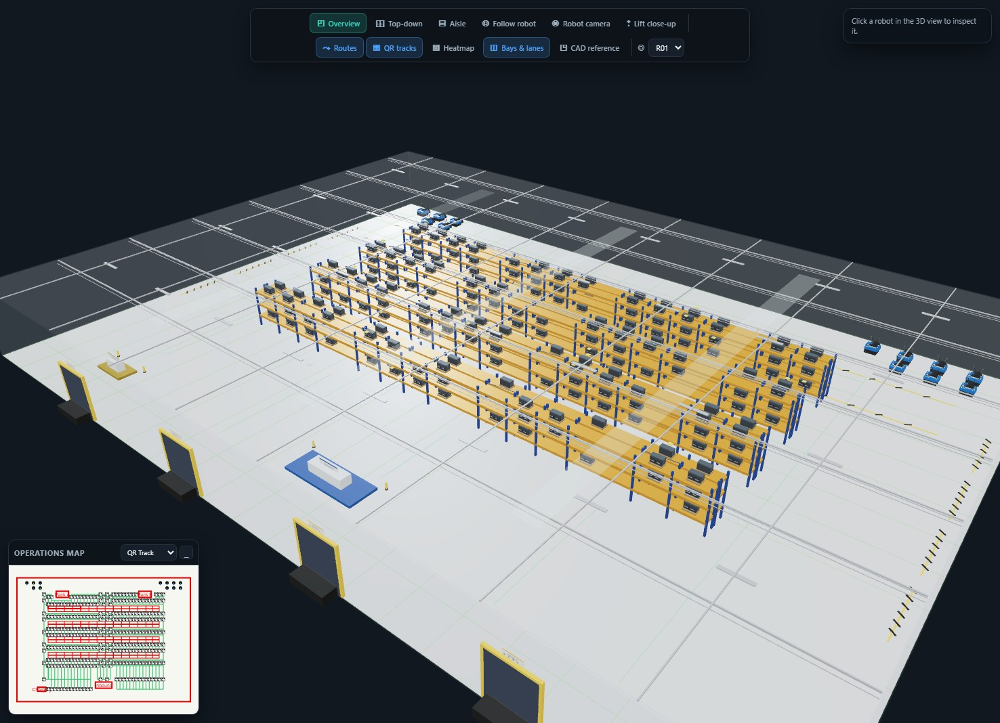

# BINO · Warehouse Swarm Lab

**A warehouse. A swarm. One coordinated system.**

An interactive 3D warehouse robotics simulator built with TypeScript and Three.js. Design a warehouse, dispatch autonomous scissor-lift robots, and inspect how a fleet navigates, handles inventory, shares space, and returns to standby.

Created by **Nabil ES-SAADI** for our **BINO project for the Capgemini competition**. Originally made in **June 2026**.

[Visit the project](https://warehouse-swarm-sim.vercel.app/) · [Open the simulator](https://warehouse-swarm-sim.vercel.app/simulator/) · [Run the jury demo](https://warehouse-swarm-sim.vercel.app/simulator/?demo=jury) · [Parameter reference](docs/SCENARIO_PARAMETERS.md)



## The idea

Warehouse automation depends on more than a robot reaching a destination. Robots must share aisles, wait for available stations, collect inventory at different shelf heights, manage battery levels, and make room for one another.

BINO makes these interactions visible. It provides an explorable simulation for demonstrating warehouse robotics, comparing scenarios, and explaining the decisions behind a moving fleet.

The homepage introduces the project; the simulator provides the full workspace. Both are served from the same Vercel deployment.

## Explore it in a minute

1. **Open the simulator.** The default warehouse and CAD reference load automatically.
2. **Select Jury Demo.** The simulator resets and dispatches a demonstration batch. The landing page's **Run the jury demo** button starts it directly.
3. **Watch the operation.** Observe robot routes, lifts, station queues, and parking behavior.
4. **Look closer.** Select a robot or use the camera toolbar to follow it, view its camera, or inspect the lift.
5. **Read the results.** Check mission progress, collisions, conflicts avoided, throughput, and parking in the competition panel.

For your own experiment, configure the warehouse and fleet, generate a batch, or dispatch an individual mission from the Missions panel.

## What you can do

| Area | Capabilities |
| --- | --- |
| **Warehouse design** | Configure floor dimensions, rack rows, bays, shelf levels, aisles, cross-aisles, and station positions. |
| **Inventory** | Generate SKU families, adjust fill rates and row rules, and import or export inventory CSV. |
| **Robot fleet** | Adjust robot count, speed, acceleration, dimensions, battery capacity, and visual models. |
| **Mission control** | Generate batches, pick from a selected slot, move to a point, and inspect each mission phase. |
| **Traffic coordination** | Explore A* routing, reservations, directional lanes, yielding, station queues, and deadlock recovery. |
| **Lift operation** | Observe shelf-dependent scissor extension, pickup, payload handling, lowering, and placement. |
| **Battery and parking** | Inspect charging behavior, return-to-standby movement, and assigned parking bays. |
| **Visualization** | Switch between overview, top-down, aisle, follow, robot camera, and lift close-up views. |
| **Analysis** | Inspect congestion, waiting, route efficiency, mission estimates, collision counts, and recorded traces. |
| **Export** | Download scenario JSON, inventory CSV, mission logs, screenshots, warehouse GLB, SDF, text-to-CAD prompts, and traces. |

### Default scenario

These are editable starting values, not performance claims:

| Setting | Default |
| --- | --- |
| Warehouse footprint | 84 × 58 metres before any geometry normalization |
| Robot fleet | 12 scissor-lift robots |
| Rack configuration | 8 rows × 14 bays × 3 shelf levels |
| Robot travel speed | 2.0 m/s |
| Simulation tick | 100 ms |
| Generated batch | 10 missions |
| Routing | Reservation table |
| Assignment | Nearest robot |

The application may adjust geometry to fit the configured racks and stations. Jury Demo also applies its own demonstration settings; the table describes the base scenario.

## Run locally

### Requirements

- Node.js and npm. This project was verified with **Node.js 24**.
- A modern browser with WebGL support; hardware acceleration is recommended for the 3D simulator.
- Python only if you want to run the optional STEP conversion utility.

From the project directory:

```bash
npm ci
npm run dev
```

Open:

- **Landing page:** [http://127.0.0.1:5173/](http://127.0.0.1:5173/)
- **Simulator:** [http://127.0.0.1:5173/simulator/](http://127.0.0.1:5173/simulator/)
- **Automatic jury demo:** [http://127.0.0.1:5173/simulator/?demo=jury](http://127.0.0.1:5173/simulator/?demo=jury)

Vite prints the actual port if the default is occupied.

### Commands

| Command | Purpose |
| --- | --- |
| `npm run dev` | Start the local development server. |
| `npm run typecheck` | Run strict TypeScript checks. |
| `npm run build` | Check TypeScript and build both pages into `dist/`. |
| `npm run preview` | Serve the production build locally, usually on port 4173. |
| `npm run test:sim` | Run the headless simulation regression suite. |
| `npm run test:browser` | Run the Playwright simulator smoke checks against a running server. |
| `npm run test:landing` | Check responsive layouts, homepage links, simulator loading, and automatic demo startup. |

## The simulator workspace

| Panel | Use it to |
| --- | --- |
| **Operations** | Control the run and inspect the state of the warehouse. |
| **Missions** | Create tasks, choose source slots or point destinations, and follow mission phases. |
| **Fleet** | Configure robots and activate robot camera views. |
| **Warehouse** | Change layout, racks, stations, and visual references. |
| **Inventory** | Manage SKU families, occupancy, row rules, and CSV files. |
| **Traffic** | Inspect coordination, queues, and traffic behavior. |
| **Analytics** | Explore operational metrics and mission analysis. |
| **Export** | Save scenarios and download data or visual artifacts. |
| **Debug** | Inspect navigation, obstacles, fleet state, and diagnostics. |

The **BINO project home** link in the simulator header returns to the landing page.

### Mission modes

**Pick and drop:** a robot travels to a reserved source slot, extends its lift, collects the payload, lowers it, travels to the target station, and places it. With the optional operator round-trip setting, the payload can return to its shelf after processing.

**Go to position:** a robot navigates to a selected X/Z destination. The mission table reports its travel phase and arrival.

Source slots are reserved during active tasks to avoid assigning the same stock to competing missions. Robots can continue with queued work before returning to their assigned standby bays.

### Traffic and collision metrics

The simulation combines a navigation graph, A* routes, reservations, directional lanes, yielding, and station queues. Its traffic logic runs in a shared browser simulation controller.

**Collisions** counts detected physical contacts. **Conflicts Avoided** describes avoidance activity. A fleet may report avoidance activity while still having zero physical contacts.

Collision-free regression scenarios demonstrate the tested configurations; they do not guarantee every possible user-created layout. Support columns are disabled by default because dense obstacle configurations can block navigation nodes and restrict routes.

## Save, import, and export

Scenarios can be saved to **the current browser's local storage**, or downloaded as JSON for transfer and later import. Browser saves are specific to the browser and origin; they are not cloud accounts or shared storage.

The Export panel supports scenario JSON, inventory CSV, mission logs, screenshot PNG, warehouse GLB, SDF world, text-to-CAD prompts, and trace JSON/CSV. File generation takes place in the browser.

Custom robot and warehouse references can be loaded as `.glb` or `.gltf` models. STEP files must be converted before browser use.

## Testing

### Simulation regression suite

```bash
npm run test:sim
```

The current suite contains **67 scenarios**, including mission chaining, shelf access, collision detection, traffic conflicts, parking, charging, round-trip payloads, and startup spacing. Results are printed as JSON. A failed scenario sets a nonzero exit code.

Generated test JavaScript is written to `smoke-build-cjs/`, which is ignored by Git and excluded from Vercel uploads.

### Browser smoke checks

Install the Chromium runtime once:

```bash
npx playwright install chromium
```

With `npm run dev` running in another terminal:

```bash
npm run test:browser
```

The test defaults to `http://127.0.0.1:5173/simulator/`. To test the production build or deployed app, set `TEST_URL` to its **simulator URL**.

PowerShell example:

```powershell
$env:TEST_URL = "http://127.0.0.1:4173/simulator/"
npm run test:browser
```

Bash example:

```bash
TEST_URL=https://warehouse-swarm-sim.vercel.app/simulator/ npm run test:browser
```

The smoke checks cover rendering, tabs, dispatch, cameras, controls, and the competition demo. Some exploratory checks report their observed state rather than assert full mission completion; use the headless suite for simulation regression coverage.

The landing-page checks default to the development homepage. Set `LANDING_URL` to another homepage URL when testing a production preview or deployment:

```powershell
$env:LANDING_URL = "http://127.0.0.1:4173/"
npm run test:landing
```

## Project structure

```text
warehouse-swarm-sim/
├── index.html                 # BINO landing page
├── simulator/index.html       # Simulator entry page
├── vite.config.ts             # Two-page production build
├── public/
│   ├── images/                # Actual simulator preview
│   └── models/                # Built-in warehouse CAD reference
├── src/
│   ├── main.ts                # Simulator initialization and frame loop
│   ├── landing.css            # Landing page styles
│   ├── styles.css             # Simulator styles
│   ├── app/                   # Defaults, state, persistence, validation
│   ├── domain/                # Geometry, routing, missions, traffic, metrics
│   ├── render/                # Three.js scene, robots, materials, exports
│   └── ui/                    # Simulator panels, maps, and scene toolbar
├── scripts/                   # Tests, diagnostics, CAD conversion, video tools
├── docs/                      # Parameter reference and Claude Code handoff
├── promo/                     # Retained demonstration media
└── .vercel/                   # Local Vercel project association; not committed
```

The landing page uses HTML and CSS and does not initialize Three.js. The simulator loads its own application bundle when opened, keeping the introduction lightweight.

## CAD reference

The built-in warehouse model is `public/models/warehouse-from-step.glb`. It was generated from a STEP reference and is loaded automatically by the simulator. Reference scale and visibility controls are available in the Warehouse panel.

To convert another tessellated STEP file:

```bash
python scripts/step_tessellation_to_glb.py Warehouse.step public/models/warehouse-from-step.glb
```

See [the parameter reference](docs/SCENARIO_PARAMETERS.md) for scenario details. See [the converter](scripts/step_tessellation_to_glb.py) for its supported input and implementation.

## Deploy on Vercel

The project is a static Vite application with two HTML entry points:

| Route | Page |
| --- | --- |
| `/` | BINO landing page |
| `/simulator/` | Interactive simulator |
| `/simulator/?demo=jury` | Simulator with automatic jury demo |

Use the **Vite** framework preset, `npm run build` as the build command, and `dist` as the output directory. No backend or application secrets are needed.

For the existing linked project, sign in and deploy from this directory:

```bash
npx vercel login
npx vercel --prod
```

Keep the existing `.vercel/project.json` association. The `.vercelignore` file excludes local tooling, documentation, recordings, and other files that the production build does not need. Required landing assets live in `public/` and are copied into `dist/`.

After deployment, check the homepage, simulator route, direct page refresh, model loading, and jury-demo link.

## Continue with Claude Code

Use the ready-to-copy [Claude Code implementation and continuation prompt](docs/CLAUDE_CODE_PROMPT.md). It describes the project, routes, author credit, design direction, regression checks, and Vercel deployment requirements.

## Author & project credit

I made this simulator for our **BINO project for the Capgemini competition**.

**Created by:** Nabil ES-SAADI  
**Date made:** June 2026  
**Copyright:** © 2026 Nabil ES-SAADI
